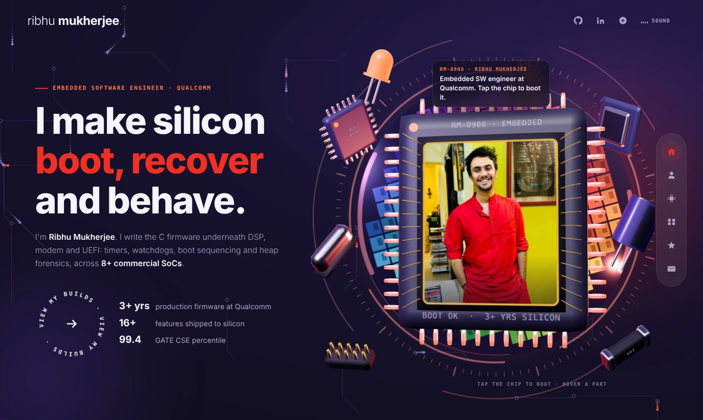
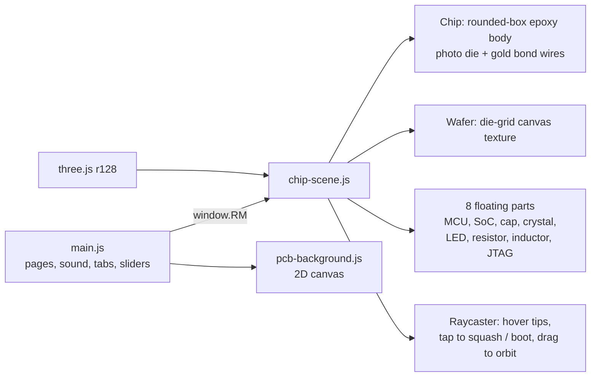

<h1 align="center">ribhu0908.github.io</h1>

<p align="center">
  Personal portfolio of <b>Ribhu Mukherjee</b>, senior embedded software engineer at Qualcomm.<br/>
  A 3D microchip whose silicon die is my photo, on a background of live PCB traces.
</p>

<p align="center">
  <a href="https://ribhu0908.github.io"></a>
  
  
</p>

<p align="center">
  <a href="https://ribhu0908.github.io"></a>
</p>

## What's on it

| Page | What it shows |
|---|---|
| **Home** | Three.js scene: a QFP chip with the photo as its die, gold bond wires, a spinning wafer and red HUD rings. Tap the chip to **boot** it: the pins glow and a scan line sweeps the die. |
| **About** | Role, stats that count up, and tabs for skills, experience, education and teaching. Skills are drawn as tiny ICs with pins. |
| **What I do** | Six cards: boot and bring-up, drivers, platform services, heap forensics, escalations, AI debug tooling. |
| **Work** | Open-source repos with real CI output, and a tab for features shipped at Qualcomm. |
| **Recognition** | Performance review, peer awards, TechFiesta, customer thanks. |
| **Contact** | A form that opens your own email app with the message filled in, plus direct links. |

## How the 3D works



- **Rounded boxes without extra libraries.** r128 has no `RoundedBoxGeometry`, so `rbox()` pushes each vertex of a subdivided box out from an inner box by the corner radius, and uses that direction as the normal. That gives the smooth clay-like edges.
- **Metal that reflects something.** A small canvas "studio" (soft boxes and a red rim band) goes through `PMREMGenerator` and is used as `scene.environment`, so the pins, crystal and wires pick up highlights.
- **Each part tells part of the story.** Hover (or tap on a phone) and a glass tooltip shows the work it stands for, placed at the part's projected screen position.
- **PCB background.** Nodes sit on a jittered grid. Each link is a straight run plus a 45° jog, like real routing. Traces near the cursor turn red and pulses run along random traces.
- **Sound is opt-in.** Pops, the boot chime and the ambient pad are synthesized with WebAudio. Nothing plays until you press *Sound*.
- **Accessibility.** If you set *reduce motion*, every animation stops and the scene renders one still frame. Pages switch with the dock, the URL hash, or PageUp/PageDown. If WebGL is not available, a plain photo is shown instead.

## Project structure

```
.
├── index.html             # markup for all six pages
├── css/style.css          # theme tokens, layout, dock, wipe transition, responsive rules
├── js/main.js             # routing + wipe, sound, tabs, sliders, count-up, contact
├── js/pcb-background.js   # animated PCB-trace canvas
├── js/chip-scene.js       # three.js hero scene
└── assets/
    ├── ribhu.jpg          # photo used as the chip die
    ├── preview.jpg        # README / link-preview image
    └── favicon.svg
```

## Run it locally

No build step. Any static server works:

```bash
git clone https://github.com/ribhu0908/ribhu0908.github.io.git
cd ribhu0908.github.io
python3 -m http.server 8000
# open http://localhost:8000
```

Use a server, not `file://`. Browsers block WebGL from reading a texture loaded from a local file.

## Credits

- Layout idea (dark theme, side dock, page wipe, rotating circular button) inspired by [sanidhyy/modern-portfolio](https://github.com/sanidhyy/modern-portfolio) (MIT). All code here is written from scratch, and the chip, wafer and PCB visuals are original.
- [three.js](https://threejs.org) r128, loaded from cdnjs.
- Fonts: Sora and JetBrains Mono from Google Fonts.

## License

The code is MIT licensed (see [LICENSE](LICENSE)). The photo and personal content are not covered by the license.
